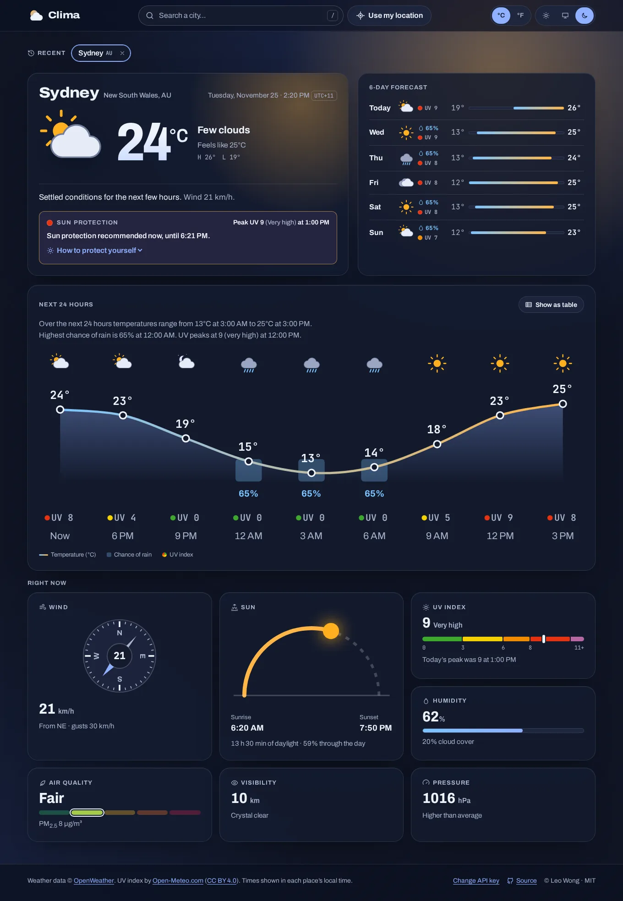
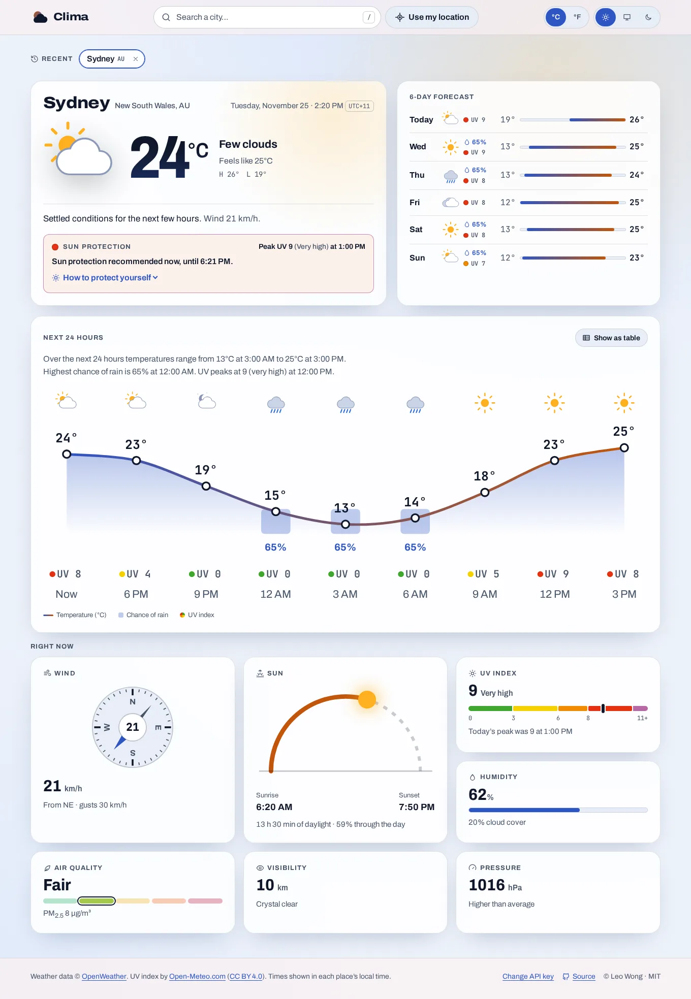
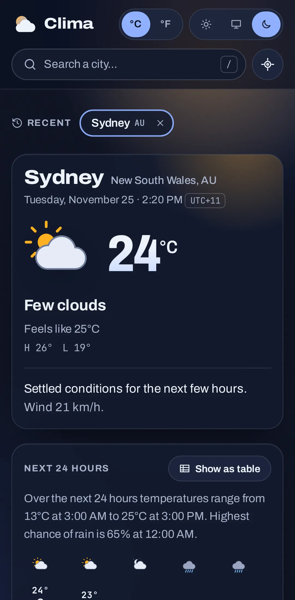
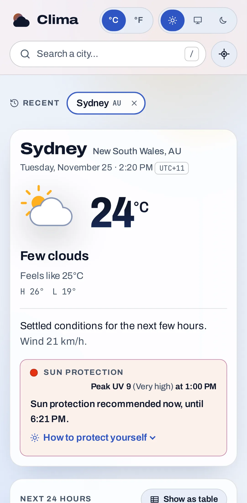
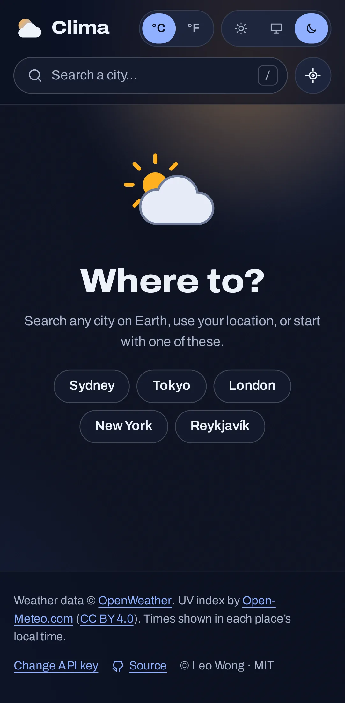

# Clima

[](https://github.com/leoelicos/clima/actions/workflows/ci.yml)


A fast, accessible weather dashboard. Search any city and get current conditions, a 24-hour chart, a 5-day forecast, wind, sun, humidity, air quality, visibility and pressure, in a sky that changes with the weather.

**Live:** [leoelicos.github.io/clima](https://leoelicos.github.io/clima/)

| Dark | Light |
| --- | --- |
|  |  |

<p align="center">
  
  
  
</p>

## Features

- **Search as you type.** WAI-ARIA combobox with debounced geocoding, full keyboard support (<kbd>↑</kbd> <kbd>↓</kbd> <kbd>Enter</kbd> <kbd>Esc</kbd>, <kbd>/</kbd> to focus) and screen reader announcements.
- **Use my location** (optional): geolocation with graceful fallbacks when it's denied or unavailable.
- **Recent places**: the last 8 places, stored locally, each removable.
- **°C / °F** and **light / system / dark** toggles, remembered between visits.
- **Current conditions** in the place's own local time, with feels-like, high/low and a plain-English summary.
- **24-hour chart**: a hand-built SVG with temperature curve, rain chance bars and a text summary, plus a **data table view**.
- **5-day forecast** with temperature range bars scaled across the week.
- **Highlights**: wind compass, sun arc, humidity, air quality (AQI), visibility and pressure.
- **Animated weather icons** and a sky that shifts with the weather and time of day. All motion respects `prefers-reduced-motion`.
- **Solid states**: skeleton loading, friendly errors with retry (bad key, rate limit, offline, server), empty state with suggestions.
- 10-minute in-memory cache and request cancellation, so switching cities is instant and never shows stale data.

## Accessibility (WCAG 2.2 AA)

- Landmarks (`header`, `search`, `nav`, `main`, `footer`), a skip link and a logical heading outline.
- Every control is reachable and usable with a keyboard; focus is always visible (3px high-contrast ring) and never hidden behind the sticky header (2.4.11).
- Colour contrast meets AA in both themes, checked by axe against real rendering in Playwright.
- Charts and icons have text alternatives: the hourly chart has a written summary and a data table; values are announced with units ("24 degrees Celsius", "from the northeast").
- Search results, loading and errors use live regions (4.1.3 Status Messages).
- Targets are at least 24×24px (2.5.8); native radio groups for toggles; works in Windows forced-colours mode.
- `prefers-reduced-motion` disables animations and view transitions.

## Tech

- [Vite 8](https://vite.dev) + [React 19](https://react.dev) + strict [TypeScript 7](https://www.typescriptlang.org)
- Modern CSS: `light-dark()`, `oklch`/`color-mix()`, `@property` animated custom properties, container queries, `:has()`, `@starting-style`, View Transitions
- No UI or charting libraries; zero runtime dependencies beyond React and two variable fonts
- [oxlint](https://oxc.rs) (React, jsx-a11y, TypeScript, Vitest, Unicorn rules)
- [Vitest](https://vitest.dev) + Testing Library + [axe-core](https://github.com/dequelabs/axe-core) for unit, component and accessibility tests
- [Playwright](https://playwright.dev) + `@axe-core/playwright` for end-to-end, keyboard and colour contrast checks on desktop and mobile
- GitHub Actions for CI and GitHub Pages deploys

## Run locally

Requires Node 22+.

```bash
npm install
cp .env.example .env.local   # then add your key (optional, see below)
npm run dev
```

Get a free API key at [home.openweathermap.org/api_keys](https://home.openweathermap.org/api_keys). New keys can take up to two hours to activate.

If you don't set a key, the app asks for one in the browser and stores it in that browser only, so a deployment without a key still works for anyone with their own.

### Scripts

| Command | What it does |
| --- | --- |
| `npm run dev` | Start the dev server |
| `npm run build` | Type-check and build to `dist/` |
| `npm run preview` | Serve the production build |
| `npm run lint` | oxlint, warnings fail |
| `npm run typecheck` | `tsc -b` |
| `npm test` | Vitest unit, component and axe tests |
| `npm run test:e2e` | Playwright e2e + axe (run `npx playwright install chromium` once) |
| `npm run check` | lint + typecheck + test + build |
| `npm run screenshots` | Regenerate `docs/screenshots` |

## Environment variables

| Name | Where | Notes |
| --- | --- | --- |
| `VITE_OPENWEATHER_API_KEY` | `.env.local`, Vercel env vars | Optional. Inlined into the client bundle at build time. |
| `OPENWEATHER_API_KEY` | GitHub repository secret | Used by the Pages workflow to set `VITE_OPENWEATHER_API_KEY`. |

> **Heads up:** any key used by a static front end is visible to visitors (it's in the network requests). Treat it as public, keep it on the free tier, and rotate it if it's abused. For a truly private key, put a small serverless proxy in front of OpenWeather (for example a Vercel Function) and call that instead.

## Deploy

### GitHub Pages (default)

1. **Settings → Pages → Build and deployment → Source: GitHub Actions.**
2. Optional: **Settings → Secrets and variables → Actions → New repository secret** `OPENWEATHER_API_KEY`.
3. Push to `main`. [`.github/workflows/pages.yml`](./.github/workflows/pages.yml) builds and deploys `dist/`.

The build uses a relative base (`./`), so it works under `/clima/` without extra config.

### Vercel

Import the repo at [vercel.com/new](https://vercel.com/new) (framework preset: Vite), add `VITE_OPENWEATHER_API_KEY` under Environment Variables, and deploy. `vercel.json` is included.

## Data

Weather data from [OpenWeather](https://openweathermap.org/): Geocoding, Current Weather, 5 day / 3 hour Forecast and Air Pollution APIs, all on the free plan. (Version 1 used the One Call 2.5 API, which OpenWeather has retired.)

## Credits

Originally built as a coding bootcamp project (BCS resources). Rebuilt in 2026.

## License

&copy; Leo Wong <leoelicos@gmail.com>. Licensed under the [MIT License](./LICENSE).
